# LogLens — Real-Time Log Monitoring & Incident Escalation Dashboard

[](https://www.oracle.com/java/)
[]()
[](https://www.sqlite.org/)
[]()
[-brightgreen.svg)]()

> **LogLens** is a lightweight, real-time desktop observability suite and incident management system written in pure Java. It tails production log streams without freezing the user interface, parses and validates log entries, detects high-frequency error bursts using a sliding time-window algorithm, groups repetitive error signatures via regex pattern masking, and tracks incidents through a persistent SQLite database with Role-Based Access Control (RBAC).

---

## Table of Contents

1. [What LogLens Does](#1-what-loglens-does)
   - [The Problem It Solves](#the-problem-it-solves)
   - [The LogLens Solution](#the-loglens-solution)
   - [Key Highlights & Capabilities](#key-highlights--capabilities)
2. [Minimum Java & System Requirements](#2-minimum-java--system-requirements)
3. [How to Run on Your Local PC](#3-how-to-run-on-your-local-pc)
   - [Prerequisites & Verification](#prerequisites--verification)
   - [Option A: 1-Click Launch on Windows (`run.bat`)](#option-a-1-click-launch-on-windows-runbat---recommended)
   - [Option B: Windows Command Prompt (CMD)](#option-b-windows-command-prompt-cmd)
   - [Option C: Windows PowerShell](#option-c-windows-powershell)
   - [Option D: macOS & Linux (Bash / Zsh)](#option-d-macos--linux-bash--zsh)
   - [Default Login Credentials](#default-login-credentials)
4. [Interactive Demo & Testing Guide](#4-interactive-demo--testing-guide)
   - [Using the Built-in Traffic Simulator](#using-the-built-in-traffic-simulator)
   - [Step-by-Step Demo Script](#step-by-step-demo-script)
5. [Standalone Console Demos](#5-standalone-console-demos)
   - [Running the CallableStatement Demo](#running-the-callablestatement-demo-mysql-stored-procedures)
6. [System Architecture & Data Flow](#6-system-architecture--data-flow)
   - [Component Data Flow](#component-data-flow)
   - [Incident Lifecycle State Machine](#incident-lifecycle-state-machine)
7. [Project & Package Structure](#7-project--package-structure)
8. [Database Schema & Persistence](#8-database-schema--persistence)
9. [Detailed Technical Mechanisms](#9-detailed-technical-mechanisms)
   - [Log Parsing & Custom Exceptions](#a-log-parsing--custom-exceptions)
   - [Sliding-Window Spike Detection](#b-sliding-window-spike-detection)
   - [Error Grouping & Pattern Masking](#c-error-grouping--pattern-masking)
   - [Incident Escalation Rules](#d-incident-escalation-rules)
   - [Multithreading & Concurrency Control](#e-multithreading--concurrency-control)
   - [Role-Based Access Control (RBAC)](#f-role-based-access-control-rbac)
10. [Academic & Syllabus Alignment](#10-academic--syllabus-alignment)
11. [Troubleshooting & FAQs](#11-troubleshooting--faqs)

---

## 1. What LogLens Does

Modern software systems and microservices generate thousands of log events every minute. When unexpected spikes or distributed outages occur, developers face critical operational hurdles:

### The Problem It Solves

- **Information Overload:** Engineers cannot manually scan scrolling terminal logs to catch intermittent issues before users are impacted.
- **Dynamic Variable Noise:** Identical exceptions caused by the same root bug produce thousands of different log lines because each line contains unique runtime variables (e.g., changing IP addresses `10.0.0.4` vs `10.0.0.7`, or transient user/order IDs `user_102` vs `user_994`).
- **Absence of State Tracking:** Traditional logging frameworks (`log4j`, `logback`, console output) output plain text lines without tracking whether an alert has been seen, assigned, or resolved.
- **Enterprise Tool Bloat:** Industrial observability stacks (such as Datadog, Splunk, or Elastic/ELK) are resource-heavy, require complex multi-node cluster setups, incur steep cloud costs, and demand dedicated DevOps support.

### The LogLens Solution

LogLens provides an **all-in-one, zero-infrastructure desktop observability platform** that requires **no external servers, no cloud subscriptions, and no complicated setup**. You simply run it directly on your machine.

LogLens acts as an intelligent sentinel:
1. It continuously tails an application's live log file in a background daemon thread.
2. It parses lines into structured data objects while quarantining corrupt or garbage logs into an audit tab.
3. It counts errors within a moving time window (e.g., last 10 seconds). If errors spike beyond a threshold, it triggers a visual alert.
4. It extracts root error signatures using regular expressions, grouping hundreds of duplicate errors into clean templates.
5. It automatically opens an incident in an embedded SQLite database, escalates severity (`MEDIUM` &rarr; `HIGH` &rarr; `CRITICAL`) as the blast radius widens, and lets operators acknowledge and resolve incidents.

### Key Highlights & Capabilities

| Feature | Description |
| :--- | :--- |
| **Non-Blocking Live Tail** | Dedicated background `Runnable` thread continuously polls `live.log` and pushes updates to the GUI safely via `SwingUtilities.invokeLater`. |
| **Robust Parsing Engine** | Validates date format, time format, and valid log levels (`INFO`, `WARN`, `ERROR`). Any malformed line triggers a checked `MalformedLogException` and is quarantined into the **Skipped Lines** audit tab with a descriptive failure reason. |
| **Sliding-Window Spike Detector** | Maintains a temporal queue of error timestamps per service (`HashMap<String, LinkedList<LocalDateTime>>`). Evicts timestamps older than the configured window (e.g. 10s) and triggers alerts without repeat spamming. |
| **Pattern Masking & Grouping** | Replaces dynamic IPv4 addresses with `<IP>` and numbers with `<N>`. Sorts and aggregates recurring error patterns to highlight the top root causes. |
| **Incident Lifecycle Management** | Backed by an embedded SQLite database (`loglens.db`). Incidents move through states: `OPEN` &rarr; `ACKNOWLEDGED` &rarr; `RESOLVED`. Severity escalates dynamically as error counts rise. |
| **Role-Based Access Control (RBAC)** | Secure login screen using one-way **SHA-256** password hashing. Distinguishes `ADMIN` operators (full access) from `VIEWER` users (read-only access). |
| **Dynamic Regex Log Search** | Real-time `TableRowSorter` filtering on live logs by keyword, service name, or error text. |
| **CSV Incident Export** | One-click export utility that writes incident post-mortem reports to timestamped CSV files in `exports/`. |
| **Persistent User Settings** | Native Java Object Serialization (`ObjectInputStream` / `ObjectOutputStream`) saves sliding-window duration, error threshold, and export directory to `settings.ser`. |
| **Built-in Traffic Simulator** | Five toolbar buttons that inject mock normal traffic, error storms, and corrupted lines so you can test and demo every feature immediately without external microservices. |

---

## 2. Minimum Java & System Requirements

### Minimum `javac` and `java` Version

| Tool / Requirement | Minimum Required Version | Recommended Version |
| :--- | :--- | :--- |
| **JDK (Java Development Kit)** | **Java 8 (JDK 1.8 / version 8)** | **Java 17 (LTS)** or **Java 21 (LTS)** |
| **`javac` Compiler** | **version 1.8.0** | **version 17.0+** or **21.0+** |
| **Operating System** | Windows 10/11, macOS 10.14+, or Linux (Ubuntu, Fedora, Arch, etc.) | Any modern 64-bit OS |
| **Build Tools** | **None!** (No Maven or Gradle required) | Standard JDK CLI (`javac`, `java`) |
| **Bundled Libraries** | `lib/sqlite-jdbc-3.36.0.3.jar` (Included in the repository) | Fully self-contained |

### Why is Java 8 the Minimum Required Version?

LogLens was deliberately engineered to be universally backwards-compatible while taking advantage of modern Java standard library capabilities:
1. **`java.time` Date & Time API:** The project utilizes `java.time.LocalDateTime`, `java.time.format.DateTimeFormatter`, and `java.time.format.DateTimeParseException` for microsecond-accurate timestamp parsing and sliding-window date arithmetic (`minusSeconds()`, `isBefore()`). These classes were introduced in **Java 8** and replaced the legacy, thread-unsafe `java.util.Date` and `SimpleDateFormat`.
2. **Diamond Operator (`<>`):** Used throughout the collection initializations (introduced in Java 7, standard in Java 8).
3. **Try-with-Resources:** Automatic resource management on database connections, statements, result sets, and file streams.
4. **Swing Event Dispatch Architecture:** Fully compatible with Java 8 through Java 21+ without any modularity warnings.

> **Note on Higher Java Versions (Java 11, 17, 21):** LogLens compiles and runs seamlessly on modern Long-Term Support (LTS) releases (Java 11, Java 17, Java 21) without requiring any additional compiler flags or configuration changes.

---

## 3. How to Run on Your Local PC

### Prerequisites & Verification

Before running, verify that you have Java installed and that `javac` is accessible from your terminal:

```bash
# 1. Check Java Runtime version
java -version

# 2. Check Java Compiler version
javac -version
```

- If both commands output a version number of **1.8.0 or higher** (e.g. `1.8.0_491`, `11.0.x`, `17.0.x`, or `21.0.x`), you are ready to go!
- If the commands are not recognized:
  - Download and install a free OpenJDK distribution such as [Eclipse Temurin (Adoptium)](https://adoptium.net/) or [Oracle JDK](https://www.oracle.com/java/technologies/downloads/).
  - Ensure the `bin` directory of your JDK installation is added to your system's `PATH` environment variable.

---

### Option A: 1-Click Launch on Windows (`run.bat` - Recommended)

The simplest way to run LogLens on Windows:

1. Open File Explorer and navigate to the project directory:
   ```
   c:\Users\<YourUser>\...\LogLens\LogLens
   ```
2. Double-click **`run.bat`**.
3. The script will:
   - Discover all `.java` files in `src/` and output `sources.txt`.
   - Create the `bin/` directory if missing.
   - Compile all source files against `lib/sqlite-jdbc-3.36.0.3.jar`.
   - Launch the GUI dashboard (`loglens.ui.AppLauncher`).

---

### Option B: Windows Command Prompt (CMD)

Open `cmd.exe`, change to the project directory, and run:

```cmd
:: 1. Generate the source files list
dir /s /b src\*.java > sources.txt

:: 2. Create the destination binary folder
if not exist bin mkdir bin

:: 3. Compile all Java source files
javac -d bin -cp "lib/sqlite-jdbc-3.36.0.3.jar" @sources.txt

:: 4. Launch the LogLens application
java -cp "bin;lib/sqlite-jdbc-3.36.0.3.jar" loglens.ui.AppLauncher
```

---

### Option C: Windows PowerShell

> [!IMPORTANT]
> **PowerShell Splatting Gotcha:** In PowerShell, the `@` symbol is reserved for variable splatting. You **must put quotes around `"@sources.txt"`**, otherwise PowerShell will throw `The splatting operator '@' cannot be used to reference variables in an expression`.

Open PowerShell in the project directory:

```powershell
# 1. Generate the list of Java source files
Get-ChildItem -Recurse -Filter *.java -Path src | Select-Object -ExpandProperty FullName | Out-File -Encoding ascii sources.txt

# 2. Create bin folder if it does not exist
if (!(Test-Path bin)) { New-Item -ItemType Directory -Path bin }

# 3. Compile (Note the quotes around "@sources.txt")
javac -d bin -cp "lib/sqlite-jdbc-3.36.0.3.jar" "@sources.txt"

# 4. Launch LogLens
java -cp "bin;lib/sqlite-jdbc-3.36.0.3.jar" loglens.ui.AppLauncher
```

---

### Option D: macOS & Linux (Bash / Zsh)

On Unix-based operating systems, path separators use forward slashes `/` and classpath entries are separated by a colon (`:`) instead of a semicolon (`;`):

```bash
# 1. Create the output directory
mkdir -p bin

# 2. Find all Java source files and compile
find src -name "*.java" > sources.txt
javac -d bin -cp "lib/sqlite-jdbc-3.36.0.3.jar" @sources.txt

# 3. Launch the application (colon separator on Unix)
java -cp "bin:lib/sqlite-jdbc-3.36.0.3.jar" loglens.ui.AppLauncher
```

---

### Default Login Credentials

When the application opens, you are greeted by the **Login Screen**. The SQLite database auto-seeds two default user accounts with pre-computed SHA-256 hashes:

| Role | Username | Password | Privileges & Access |
| :--- | :--- | :--- | :--- |
| **Administrator** | `admin` | `admin123` | **Full Access:** View logs, acknowledge & resolve incidents, export CSV reports, access settings, and trigger traffic simulations. |
| **Viewer** | `viewer` | `viewer123` | **Read-Only:** View logs, inspect patterns, and read incidents. Incident action buttons (**Acknowledge**, **Resolve**) and **Handled by** are disabled. |

---

## 4. Interactive Demo & Testing Guide

### Using the Built-in Traffic Simulator

At the bottom of the main dashboard, you will find five dedicated simulation buttons. These allow you to demonstrate every feature of LogLens on demand without running external web services:


1. **`Normal traffic (20 lines)`**
   - Appends 20 valid log entries across services (`payment-service`, `auth-service`, `order-service`) with `INFO` and `WARN` levels to `live.log`.
   - **What to observe:** Switch to the **Live Logs** tab. Watch lines scroll in real time. Notice custom table row coloring (clean white for `INFO`, gentle yellow for `WARN`).
2. **`Error burst: payment-service (12)`**
   - Injects 12 rapid `ERROR` log lines for `payment-service` within seconds.
   - **What to observe:** 
     - The top status banner flashes a **bright red pinned alert**: `[ALERT] SPIKE ALERT: payment-service (12 errors in the last 10 seconds)`.
     - Switch to the **Incidents** tab: A new incident for `payment-service` appears with status `OPEN` and severity escalated directly to `CRITICAL` (since errors &ge; 10).
3. **`Error burst: auth-service (6)`**
   - Injects 6 rapid `ERROR` log lines for `auth-service`.
   - **What to observe:** Triggers a spike alert and generates an incident with severity `HIGH` (since errors &ge; 5).
4. **`Garbage lines`**
   - Injects 3 corrupted lines (one with missing tokens, one with an invalid log level `DEBUG`, and one with an invalid timestamp `2026-10-18 99:99:99`).
   - **What to observe:** 
     - The fourth tab dynamically re-labels itself to **`Skipped Lines (3)`**.
     - Switch to the **Skipped Lines** tab to see the audit trail showing timestamp, rejection reason, and raw line content without polluting the clean log view.
5. **`Settings`**
   - Opens a dialog to adjust the sliding time-window duration (seconds), error burst threshold, and CSV export folder.
   - **What to observe:** Changes are serialized to `settings.ser` on disk immediately.

---

### Step-by-Step Demo Script

For presentations, viva evaluations, or peer reviews, follow this 3-minute walkthrough:

```
[0:00 - 0:30]  LAUNCH & LOGIN
               • Run run.bat.
               • Log in with "admin" / "admin123".
               • Point out CardLayout transition and user status header.

[0:30 - 1:00]  LIVE LOGS & REGEX SEARCH
               • Click "Normal traffic (20 lines)".
               • Show live table scrolling.
               • Type "payment" into the search box to demonstrate regex filtering.

[1:00 - 1:45]  ERROR BURST & DYNAMIC ESCALATION
               • Click "Error burst: payment-service (12)".
               • Highlight the pinned red SPIKE ALERT banner at the top.
               • Switch to the "Incidents" tab. Show severity marked "CRITICAL".
               • Type your name in "Handled by" and click "Acknowledge" (status becomes ACKNOWLEDGED).
               • Click "Resolve" (status becomes RESOLVED, unblocking future alerts).

[1:45 - 2:15]  PATTERN MASKING & AGGREGATION
               • Switch to the "Patterns" tab.
               • Show how PatternMasker converted variable IPs and IDs into <IP> and <N>.
               • Show aggregated hit counts for unified error signatures.

[2:15 - 2:40]  SKIPPED LINES AUDITING & CSV EXPORT
               • Click "Garbage lines". Show tab updating to "Skipped Lines (3)".
               • Switch to "Skipped Lines" tab to view parser rejection diagnostics.
               • Switch back to "Incidents" and click "Export CSV". Verify file in exports/.

[2:40 - 3:00]  ROLE-BASED ACCESS CONTROL (RBAC)
               • Click "Logout".
               • Log in as "viewer" / "viewer123".
               • Show that Acknowledge and Resolve buttons are disabled for read-only users.
```

---

## 5. Standalone Console Demos

In addition to the interactive Swing dashboard (`AppLauncher`), LogLens includes standalone console programs demonstrating specific subsystems in isolation:

| Command to Run | Class | Purpose & Subsystem Demonstrated |
| :--- | :--- | :--- |
| `java -cp "bin;lib/sqlite-jdbc-3.36.0.3.jar" loglens.Main` | `loglens.Main` | **Batch Log Analyzer:** Reads `sample.log`, demonstrates polymorphic parsing (`LogParser`), catches `MalformedLogException`, runs `SpikeDetector`, and prints batch summary metrics. |
| `java -cp "bin;lib/sqlite-jdbc-3.36.0.3.jar" loglens.LiveDemo` | `loglens.LiveDemo` | **Concurrent Producer-Consumer:** Background `LogWatcher` thread tails `live.log` while the main thread generates traffic. Implements `LogListener` callback. |
| `java -cp "bin;lib/sqlite-jdbc-3.36.0.3.jar" loglens.DbDemo` | `loglens.DbDemo` | **SQLite JDBC Operations:** Initializes SQLite schema, inserts sample incidents, tests queries (`findAllOpen()`, `findById()`), updates statuses, and demonstrates SHA-256 user authentication. |
| `java -cp "bin;lib/sqlite-jdbc-3.36.0.3.jar" loglens.IncidentDemo` | `loglens.IncidentDemo` | **Automated Escalation Pipeline:** Simulates error bursts, verifies automated incident creation via `IncidentManager`, and asserts severity escalation (`MEDIUM` &rarr; `CRITICAL`). |
| `java -cp "bin;lib/sqlite-jdbc-3.36.0.3.jar;lib/mysql-connector-j-8.0.33.jar" loglens.CallableDemo` | `loglens.CallableDemo` | **MySQL CallableStatement Demo:** Connects to MySQL, defines and executes stored procedures demonstrating `IN`, `OUT`, and `INOUT` parameters as well as `ResultSet` streaming. |

*(Note: Replace `;` with `:` if running on macOS or Linux).*

### Running the CallableStatement Demo (MySQL Stored Procedures)

While the main LogLens application uses embedded SQLite so it can run out-of-the-box with zero database setup, SQLite does not natively support stored procedures. To demonstrate the `CallableStatement` interface required by enterprise Java syllabi, LogLens includes a dedicated standalone demonstration in `loglens.CallableDemo` utilizing **MySQL**.

#### Why SQLite for the Main App vs. MySQL for CallableStatement?
The main LogLens application intentionally runs on **SQLite** because it is completely serverless, zero-configuration, and requires no external database server or credentials—making the project 100% portable, reliable to demonstrate, and effortless to submit. However, because embedded SQLite engines lack native support for stored procedures, the `CallableStatement` interface is demonstrated in a separate, isolated module using **MySQL**, allowing full exploration of server-side stored procedures, procedural compilation, parameter binding, and IN/OUT data exchange without introducing complex server dependencies to the core application.

#### Steps to Run CallableDemo:

1. **Ensure MySQL is installed and running** on your local machine (default port: `3306`).
2. **Create your configuration file:**
   - Copy `mysql.properties.example` to `mysql.properties`:
     ```cmd
     copy mysql.properties.example mysql.properties
     ```
   - Open `mysql.properties` in a text editor and enter your local MySQL password:
     ```properties
     url=jdbc:mysql://localhost:3306/loglens_demo?createDatabaseIfNotExist=true&useSSL=false&allowPublicKeyRetrieval=true
     user=root
     password=YOUR_MYSQL_PASSWORD_HERE
     ```
   *(Note: `mysql.properties` is listed in `.gitignore` so your personal credentials will never be committed).*
3. **Execute the demo:**
   - On Windows:
     ```cmd
     java -cp "bin;lib/sqlite-jdbc-3.36.0.3.jar;lib/mysql-connector-j-8.0.33.jar" loglens.CallableDemo
     ```
   - On macOS/Linux:
     ```bash
     java -cp "bin:lib/sqlite-jdbc-3.36.0.3.jar:lib/mysql-connector-j-8.0.33.jar" loglens.CallableDemo
     ```
4. **What the demo demonstrates:**
   - **Procedure 1 (`incident_count_by_status`):** `IN` parameter (status) and `OUT` parameter (count registered via `Types.INTEGER` and retrieved via `getInt()`).
   - **Procedure 2 (`incidents_by_severity`):** `IN` parameter (severity) returning an active `ResultSet` table.
   - **Procedure 3 (`bump_severity`):** `INOUT` parameter (`Types.VARCHAR`) that takes `MEDIUM` and mutates it to `HIGH`.

---

## 6. System Architecture & Data Flow

### Component Data Flow

```text
               ┌───────────────────────┐
               │    live.log File      │
               └──────────┬────────────┘
                          │
                          ▼ (Reads line-by-line)
               ┌───────────────────────┐
               │   LogWatcher Thread   │  (Runnable, volatile running flag)
               └──────────┬────────────┘
                          │
                          ▼ (Validates format)
               ┌───────────────────────┐   Malformed   ┌───────────────────────────┐
               │     AppLogParser      ├──────────────►│    Skipped Lines Tab      │
               └──────────┬────────────┘               │ (MalformedLogException)   │
                          │ Valid LogEntry             └───────────────────────────┘
                          ▼
               ┌───────────────────────┐
               │  LogListener Pipeline │
               └─────┬───────────┬─────┘
                     │           │
       ┌─────────────▼──┐     ┌──▼────────────────┐
       │ SpikeDetector  │     │   ErrorGrouper    │
       │ (Sliding Win)  │     │  (PatternMasker)  │
       └─────┬──────────┘     └──┬────────────────┘
             │ Spikes            │ Masked Signatures
             ▼                   ▼
       ┌───────────────────────────────┐
       │        IncidentManager        │  (Escalates severity MEDIUM -> HIGH -> CRITICAL)
       └──────────────┬────────────────┘
                      │
                      ▼ (JDBC PreparedStatements)
       ┌───────────────────────────────┐
       │   IncidentDAO / UserDAO       │
       └──────────────┬────────────────┘
                      │
                      ▼
       ┌───────────────────────────────┐
       │      SQLite: loglens.db       │
       └──────────────┬────────────────┘
                      │
                      ▼ (SwingUtilities.invokeLater)
       ┌───────────────────────────────┐
       │      Swing UI Dashboard       │
       │   [Live] [Incidents] [Patterns│
       └───────────────────────────────┘
```

### Incident Lifecycle State Machine

```mermaid
stateDiagram-v2
    [*] --> OPEN: Error burst crosses threshold in SpikeDetector
    OPEN --> OPEN: Additional errors arrive (Escalates MEDIUM -> HIGH -> CRITICAL)
    OPEN --> ACKNOWLEDGED: Operator sets handled_by and clicks Acknowledge
    ACKNOWLEDGED --> ACKNOWLEDGED: Additional errors arrive (Escalates severity)
    ACKNOWLEDGED --> RESOLVED: Operator clicks Resolve
    OPEN --> RESOLVED: Operator directly resolves incident
    RESOLVED --> [*]: Incident archived; service unblocked for future incidents
```



---

## 7. Project & Package Structure

```text
LogLens/
├── .gitignore                      # Git ignore rules (.class, *.db, *.ser, etc.)
├── README.md                       # Comprehensive project documentation
├── run.bat                         # 1-click Windows compilation & launch script
├── live.log                        # Live tail target file (auto-created on run)
├── sample.log                      # Sample static log file for batch demonstration
├── loglens.db                      # Embedded SQLite database (tables: incidents, users)
├── settings.ser                    # Serialized runtime configuration file
├── mysql.properties.example        # Template configuration for MySQL CallableStatement demo
├── sources.txt                     # Discovered list of Java files for compiler
├── bin/                            # Compiled JVM bytecode (.class files)
├── docs/                           # Documentation, demo script, and viva guides
│   └── DEMO_SCRIPT.md              # Minute-by-minute demo script & top 8 viva Q&As
├── exports/                        # Destination directory for CSV incident exports
│   └── incidents_*.csv             # Exported incident reports
├── sql/                            # SQL scripts
│   └── mysql_setup.sql             # MySQL schema & stored procedures for Workbench / CLI
├── lib/                            # Bundled libraries
│   ├── sqlite-jdbc-3.36.0.3.jar   # Official SQLite JDBC driver
│   └── mysql-connector-j-8.0.33.jar # Official MySQL JDBC driver (for CallableDemo)
└── src/                            # Java source code root
    └── loglens/
        ├── Main.java               # Batch log parsing & analysis demo
        ├── LiveDemo.java           # Multi-threaded live tail & simulation demo
        ├── DbDemo.java             # SQLite database CRUD operations demo
        ├── IncidentDemo.java       # Automated incident escalation demo
        ├── CallableDemo.java       # MySQL CallableStatement stored procedures demo (IN, OUT, INOUT)
        │
        ├── model/                  # Domain entity models
        │   ├── LogEntry.java       # Immutable parsed log line (timestamp, level, service, message)
        │   ├── Incident.java       # Tracked incident entity with lifecycle status & timestamps
        │   ├── User.java           # User account model with credentials and role (ADMIN / VIEWER)
        │   └── Settings.java       # Serializable application preferences
        │
        ├── parser/                 # Log parsing abstractions & implementations
        │   ├── LogParser.java      # Abstract base parser declaring parse() contract & validation
        │   └── AppLogParser.java   # Space-delimited parser using StringTokenizer & LocalDateTime
        │
        ├── exception/              # Custom domain exceptions
        │   └── MalformedLogException.java # Checked exception storing line content and failure reason
        │
        ├── engine/                 # Real-time processing & detection engine
        │   ├── LogListener.java    # Observer callback interface (onEntry, onSpike, onMalformed)
        │   ├── LogWatcher.java     # Background daemon thread tailing live.log via polling
        │   ├── SpikeDetector.java  # Sliding-window algorithm detecting error bursts
        │   ├── ErrorGrouper.java   # Thread-safe aggregator grouping masked error patterns
        │   └── IncidentManager.java# Pipeline coordinator managing lifecycle & severity escalation
        │
        ├── dao/                    # Data Access Object persistence layer
        │   ├── DBConnection.java   # SQLite JDBC connection manager & table schema creator
        │   ├── IncidentDAO.java    # CRUD operations & state management for incidents table
        │   └── UserDAO.java        # User authentication, password verification, & seeding
        │
        ├── util/                   # Utility helpers
        │   ├── PatternMasker.java  # Regex utility masking IPs and numbers to <IP> and <N>
        │   ├── PasswordUtil.java   # SHA-256 cryptographic hashing utility
        │   ├── SettingsStore.java  # Java Object Serialization for user settings
        │   ├── IncidentExporter.java # CSV generator for incident post-mortems
        │   └── LogGenerator.java   # Multi-service synthetic log traffic generator
        │
        └── ui/                     # Java Swing / AWT desktop presentation layer
            ├── AppLauncher.java    # GUI entry point, theme setup, & component wiring
            ├── MainFrame.java      # Top-level window managing CardLayout navigation
            ├── LoginPanel.java     # Authentication card with keyboard Enter listener
            ├── LiveLogPanel.java   # Live log stream table with search filtering & color cell renderers
            ├── IncidentPanel.java  # Incidents table with Acknowledge/Resolve controls & CSV export
            ├── PatternPanel.java   # Ranked top-error signature breakdown table
            ├── SkippedPanel.java   # Audit table displaying rejected malformed lines
            └── SettingsDialog.java # Modal dialog for adjusting thresholds & preferences
```

---

## 8. Database Schema & Persistence

LogLens uses an embedded SQLite database (`loglens.db`). No database server installation or configuration is needed; the file is created and managed automatically.

### Table: `incidents`

Stores all tracked incident lifecycles:

```sql
CREATE TABLE IF NOT EXISTS incidents (
    id               INTEGER PRIMARY KEY AUTOINCREMENT,
    service          TEXT NOT NULL,
    pattern          TEXT NOT NULL,
    severity         TEXT NOT NULL,        -- 'MEDIUM', 'HIGH', 'CRITICAL'
    status           TEXT NOT NULL,        -- 'OPEN', 'ACKNOWLEDGED', 'RESOLVED'
    opened_at        TEXT NOT NULL,        -- ISO-8601 formatted timestamp
    acknowledged_at  TEXT,                 -- Nullable timestamp
    resolved_at      TEXT,                 -- Nullable timestamp
    handled_by       TEXT                  -- Name of operator handling the incident
);
```

### Table: `users`

Stores credentials and roles for authentication:

```sql
CREATE TABLE IF NOT EXISTS users (
    id             INTEGER PRIMARY KEY AUTOINCREMENT,
    username       TEXT UNIQUE NOT NULL,
    password_hash  TEXT NOT NULL,          -- SHA-256 hexadecimal hash
    role           TEXT NOT NULL           -- 'ADMIN' or 'VIEWER'
);
```

### File: `settings.ser`

Stores user preferences via native Java Object Serialization:
- `windowSeconds` (Default: `10` seconds)
- `threshold` (Default: `3` errors)
- `exportDirectory` (Default: `exports`)

---

## 9. Detailed Technical Mechanisms

### A. Log Parsing & Custom Exceptions

Standard log lines follow the format:
```text
YYYY-MM-DD HH:MM:SS LEVEL SERVICE MESSAGE
```
*Example:* `2026-10-18 14:03:22 ERROR payment-service Timeout connecting to DB at 10.0.0.4`

In `AppLogParser.java`:
1. `StringTokenizer` extracts the first 4 tokens: Date, Time, Level, and Service.
2. The log level is validated against allowed values (`INFO`, `WARN`, `ERROR`).
3. `LocalDateTime.parse()` parses the date and time using `DateTimeFormatter.ofPattern("yyyy-MM-dd HH:mm:ss")`.
4. Any violation (null line, fewer than 5 tokens, illegal log level, or invalid date values like month `13` or hour `99`) throws a checked **`MalformedLogException`**.
5. Rather than crashing the application, `LogWatcher` catches `MalformedLogException` and invokes `listener.onMalformed(line, reason)`, routing the corrupt line directly to the **Skipped Lines** audit tab.

### B. Sliding-Window Spike Detection

In `SpikeDetector.java`:
- For each service, recent error timestamps are stored in a `LinkedList<LocalDateTime>`.
- When an error arrives:
  1. The new timestamp is appended to the tail of the list: $O(1)$.
  2. The cutoff timestamp is computed: `cutoff = currentTimestamp.minusSeconds(windowSeconds)`.
  3. Expired timestamps at the head of the list that occurred before `cutoff` are evicted: `removeFirst()` $O(1)$.
  4. If `timestamps.size() >= threshold` and the service is not already in an active spike, a **Spike Alert** triggers.
  5. The `inSpike` boolean flag prevents spamming alerts for every subsequent error in the same burst.

### C. Error Grouping & Pattern Masking

In distributed architectures, identical errors contain dynamic runtime parameters (IPs, user IDs, ports).
In `PatternMasker.java`:
1. **IP Masking First:** Replaces IPv4 strings (`\\b\\d{1,3}\\.\\d{1,3}\\.\\d{1,3}\\.\\d{1,3}\\b`) with `<IP>`.
2. **Number Masking Second:** Replaces remaining sequences of digits (`\\d+`) with `<N>`.

*Why order matters:* If numbers were masked first, an IP address like `10.0.0.4` would become `<N>.<N>.<N>.<N>`, destroying its structure and preventing the IP regex from matching!

### D. Incident Escalation Rules

In `IncidentManager.java`, when errors occur for an active incident:
- $\text{errors} \ge 10 \implies$ Severity escalates to **`CRITICAL`**
- $\text{errors} \ge 5 \implies$ Severity escalates to **`HIGH`**
- $\text{errors} < 5 \implies$ Severity remains **`MEDIUM`**

Escalation is strictly monotonic: an incident's severity can escalate upward as error volume climbs, but never de-escalates while open.

### E. Multithreading & Concurrency Control

- **`LogWatcher` Background Thread:** Implements `Runnable` and loops with `Thread.sleep(500)` to tail `live.log`. The control flag `running` is declared `volatile` to guarantee immediate CPU cache flush and visibility when the main thread calls `stop()`.
- **Thread Synchronization:** Methods in `SpikeDetector` and `ErrorGrouper` are marked `synchronized` because the background thread mutates collections while the Swing Event Dispatch Thread (EDT) reads from them.
- **EDT Safety (`SwingUtilities.invokeLater`):** Java Swing is not thread-safe. All table updates, label changes, and card flips are dispatched via `SwingUtilities.invokeLater()` to prevent deadlocks and UI rendering corruption.

### F. Role-Based Access Control (RBAC)

Passwords are never stored in plaintext. `PasswordUtil.hash()` computes a standard **SHA-256** digest:
$$\text{Hash} = \text{SHA-256}(\text{password})$$

Upon login:
- If `role.equals("ADMIN")`: All buttons, incident actions, CSV export, and settings are fully enabled.
- If `role.equals("VIEWER")`: The dashboard invokes `incidentPanel.setReadOnly(true)`, disabling the **Acknowledge**, **Resolve**, and **Handled by** controls.

---

## 10. Academic & Syllabus Alignment

LogLens is structured to demonstrate core Computer Science and Object-Oriented Software Engineering concepts:

| Curriculum Unit | Core Syllabus Topics | Implemented Classes in LogLens | Real-World Application |
| :--- | :--- | :--- | :--- |
| **Unit I: OOP Fundamentals** | Classes, Objects, Encapsulation, Immutability, Constructors | `LogEntry`, `Incident`, `User`, `Settings` | Strongly typed domain entities with private fields, defensive getters, and custom `toString()` formatting. |
| **Unit II: Polymorphism & Exceptions** | Abstract Classes, Interfaces, Checked Exceptions, Exception Propagation | `LogParser`, `AppLogParser`, `LogListener`, `MalformedLogException` | Abstract parsing contract, custom checked exception handling with `try-catch-finally`, decoupling ingestion from visualization. |
| **Unit III: Multithreading & I/O** | `Runnable`, Concurrency, `volatile`, File Streams, Object Serialization | `LogWatcher`, `SettingsStore`, `IncidentExporter` | Non-blocking file tailing on background daemon thread; object persistence via `ObjectOutputStream`; thread visibility with `volatile`. |
| **Unit IV: Collections & Generics** | Generics, Lists, Queues, HashMaps, Regex, Custom Comparators | `SpikeDetector`, `ErrorGrouper`, `PatternMasker` | Sliding-window time tracking with `LinkedList`, frequency aggregation with `HashMap`, and regex tokenization. |
| **Unit V: GUI & Database (JDBC)** | Swing/AWT, `CardLayout`, `JTable`, Event Dispatch Thread, JDBC (`Statement`, `PreparedStatement`, `CallableStatement`) | `MainFrame`, `LoginPanel`, `DBConnection`, `IncidentDAO`, `UserDAO`, `CallableDemo` | Desktop dashboard with `CardLayout` card flips; parameterized queries via `PreparedStatement` preventing SQL injection; `CallableStatement` is demonstrated in `CallableDemo` with MySQL stored procedures (IN, OUT, and INOUT parameters). |

> **Note on Database Engines & `CallableStatement`:** The main LogLens desktop application runs on **SQLite** (`Statement`, `PreparedStatement`) because SQLite is serverless, zero-config, and embeddable without requiring any local database service to be running. However, because SQLite lacks native stored procedure support, **CallableStatement** is demonstrated via a dedicated standalone module (`loglens.CallableDemo`) connected to **MySQL**, showcasing stored procedures with `IN`, `OUT`, and `INOUT` parameters as well as `ResultSet` streaming.

---

## 11. Troubleshooting & FAQs

### Q1: `javac` or `java` is not recognized as an internal or external command
- **Cause:** Java is either not installed or its `bin` folder is missing from your system `PATH`.
- **Solution:** 
  1. Open Windows Search, type **Environment Variables**, and click **Edit the system environment variables**.
  2. Under System Variables, find `Path` and click **Edit**.
  3. Add the path to your JDK's `bin` directory (e.g. `C:\Program Files\Eclipse Adoptium\jdk-17.0.x\bin` or `C:\Program Files\Java\jdk1.8.0_xxx\bin`).
  4. Restart your Command Prompt or PowerShell.

### Q2: PowerShell shows `The splatting operator '@' cannot be used...`
- **Cause:** In PowerShell, `@sources.txt` is treated as variable splatting.
- **Solution:** Enclose `@sources.txt` in double quotes:
  ```powershell
  javac -d bin -cp "lib/sqlite-jdbc-3.36.0.3.jar" "@sources.txt"
  ```
  Or run through `cmd /c` or use the provided `run.bat`.

### Q3: `ClassNotFoundException: org.sqlite.JDBC`
- **Cause:** The SQLite JDBC driver is not on the classpath during execution.
- **Solution:** Ensure you specify the `-cp` flag when running `java`:
  - On Windows: `-cp "bin;lib/sqlite-jdbc-3.36.0.3.jar"` (semicolon separator)
  - On macOS/Linux: `-cp "bin:lib/sqlite-jdbc-3.36.0.3.jar"` (colon separator)

### Q4: Database is locked (`SQLException: database is locked`)
- **Cause:** Another process or previous instance of LogLens has an open write transaction on `loglens.db`.
- **Solution:** Close any background `java` processes via Task Manager (or run `taskkill /f /im java.exe` in Windows CMD), then relaunch.

### Q5: How do I reset the database to a clean initial state?
- **Solution:** Simply delete `loglens.db` in the project root. On the next launch, LogLens will automatically recreate the database tables and re-seed the default `admin` and `viewer` accounts.

---

## License

This project is open-source and intended for educational, academic, and evaluation purposes.
